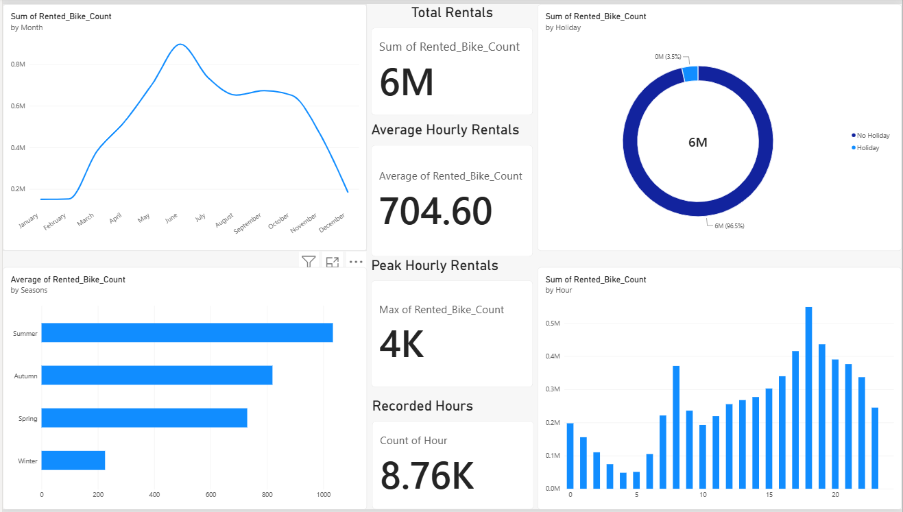
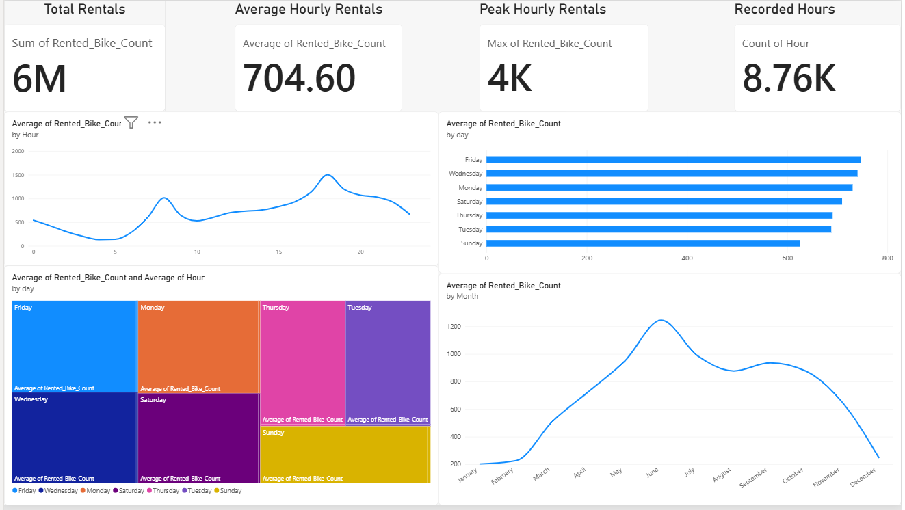
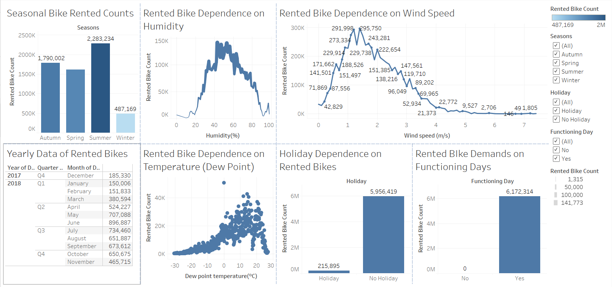

# Bike Sharing Demand Prediction
### Machine Learning | Exploratory Data Analysis | Power BI | Tableau

An end-to-end data analytics and machine learning project focused on understanding bike-sharing usage patterns and predicting rental demand using historical, temporal, and environmental data.

The project combines exploratory data analysis, statistical hypothesis testing, regression modelling, and interactive business intelligence dashboards to translate raw bike-sharing data into actionable insights.

---

## Table of Contents

- [Project Overview](#project-overview)
- [Business Problem](#business-problem)
- [Project Objectives](#project-objectives)
- [Dataset](#dataset)
- [Technology Stack](#technology-stack)
- [Project Workflow](#project-workflow)
- [Exploratory Data Analysis](#exploratory-data-analysis)
- [Machine Learning Approach](#machine-learning-approach)
- [Power BI Dashboard](#power-bi-dashboard)
- [Tableau Dashboard](#tableau-dashboard)
- [Business Insights and Applications](#business-insights-and-applications)
- [Repository Structure](#repository-structure)
- [Installation and Usage](#installation-and-usage)
- [Future Improvements](#future-improvements)
- [Skills Demonstrated](#skills-demonstrated)
- [Author](#author)

---

## Project Overview

Bike-sharing services generate valuable data about rental behaviour, weather conditions, seasonal changes, and hourly travel patterns.

This project analyses bike-sharing data to identify the factors associated with rental demand and develops regression-based machine learning models to estimate demand under different conditions.

The project integrates three complementary approaches:

- **Data Analytics:** Understand trends, distributions, correlations, and demand patterns.
- **Machine Learning:** Develop and evaluate regression models for demand prediction.
- **Business Intelligence:** Present findings through Power BI and Tableau dashboards.

The objective is to demonstrate how data science can support operational planning, resource allocation, and data-driven decision-making for shared mobility services.

## Business Problem

Bike-sharing operators must balance bike availability with fluctuating customer demand.

Insufficient availability during peak periods can lead to missed rentals, while excessive availability during low-demand periods can increase operating and redistribution costs.

This project addresses the following questions:

- How does bike rental demand change over time?
- What relationships exist between weather conditions and rental activity?
- Which factors are most strongly associated with demand?
- Can regression models estimate bike rental demand from available features?
- How can analytical findings be communicated effectively through dashboards?

## Project Objectives

1. Perform data cleaning and exploratory data analysis.
2. Identify temporal, seasonal, and environmental patterns in bike rentals.
3. Investigate relationships between numerical and categorical variables.
4. Apply statistical techniques such as Pearson correlation and ANOVA where appropriate.
5. Develop and compare regression models.
6. Apply hyperparameter tuning to improve model performance.
7. Build interactive Power BI and Tableau visualizations.
8. Translate analytical findings into practical operational recommendations.

## Dataset

The repository includes the following data files:

| File | Purpose |
|---|---|
| `SeoulBikeData.csv` | Original Seoul bike-sharing dataset |
| `revised_bike_sharing_data.csv` | Revised dataset used for further analysis |

The Seoul dataset contains information about rental counts and associated temporal and environmental conditions. Confirm the exact columns and target variable in each dataset before combining or comparing results.

Potential analytical variables include:

- Date and time-related fields
- Temperature and perceived temperature
- Humidity and wind speed
- Weather conditions
- Holiday and functioning-day indicators
- Bike rental counts

**Target variable:** Bike rental demand, represented by the rental-count field available in the selected dataset.

**Data preparation:** Inspect missing values, duplicates, data types, outliers, and inconsistent records before modelling.

> Note: The original Seoul dataset and any revised dataset may have different schemas and target-column names. Keep their preprocessing and model evaluation consistent with the notebook implementations.

## Technology Stack

| Technology | Application |
|---|---|
| Python | Data analysis and machine learning |
| Pandas | Data manipulation and preprocessing |
| NumPy | Numerical computations |
| Matplotlib | Statistical and exploratory visualizations |
| Seaborn | Relationship analysis and distribution plots |
| Scikit-learn | Regression modelling and evaluation |
| XGBoost | Gradient-boosted regression, where configured |
| Jupyter Notebook | Experimentation and documentation |
| Power BI | Interactive dashboard development |
| Tableau | Visual analytics and dashboard development |
| Git and GitHub | Version control and project documentation |

## Project Workflow

### 1. Data Understanding and Preparation

- Load the source datasets.
- Review the number of records, columns, and data types.
- Check missing values and duplicate records.
- Convert date-related fields into suitable formats.
- Investigate outliers and unusual observations.
- Prepare analytical features for statistical analysis and modelling.

### 2. Exploratory Data Analysis (EDA)

- Examine the distribution of rental demand.
- Analyse hourly, daily, monthly, and seasonal trends where supported by the dataset.
- Explore demand variation across weather conditions.
- Investigate correlations between numerical variables.
- Compare demand across categorical groups.
- Use visualizations to identify potential demand drivers.

### 3. Statistical Analysis

The project explores statistical techniques to investigate relationships and differences in bike rental demand.

- **Pearson correlation:** Examine linear relationships between numerical variables.
- **ANOVA:** Evaluate whether mean demand differs across appropriate categorical groups.
- **Hypothesis testing:** Assess whether observed differences provide sufficient statistical evidence.

Statistical assumptions should be checked before interpreting test results.

### 4. Machine Learning

Develop and compare regression models to estimate bike rental demand.

The repository identifies the following modelling approaches:

- Linear Regression
- Random Forest Regressor
- XGBoost Regressor

Model selection and hyperparameter tuning are performed according to the notebook workflow.

### 5. Visualization and Reporting

- Create analytical charts in Python.
- Present business KPIs and demand patterns in Power BI.
- Develop complementary visual analytics in Tableau.
- Translate model and dashboard findings into operational recommendations.

## Exploratory Data Analysis

The EDA component is designed to investigate several important dimensions of bike-sharing demand.

| Analysis | Business Question |
|---|---|
| Demand distribution | Is rental activity concentrated in particular demand ranges? |
| Time-based analysis | When does rental activity increase or decrease? |
| Seasonal analysis | How does demand vary across seasons or months? |
| Weather analysis | How are rental patterns associated with weather conditions? |
| Correlation analysis | Which numerical variables have meaningful relationships? |
| Group comparisons | Do average rental levels differ across selected categories? |
| Outlier analysis | Are there unusual demand or environmental observations? |

Recommended visualizations include hourly demand charts, seasonal comparisons, weather-based demand plots, correlation heatmaps, and actual-versus-predicted comparisons.

## Machine Learning Approach

### Models

**Linear Regression**

Provides a baseline for understanding relationships between input variables and rental demand.

**Random Forest Regressor**

Captures nonlinear relationships and interactions between features through an ensemble of decision trees.

**XGBoost Regressor**

Uses gradient boosting to learn complex relationships and can provide strong performance on structured tabular data.

### Model Evaluation

Use appropriate regression metrics to compare the models:

- **MAE:** Average absolute prediction error.
- **RMSE:** Penalizes larger prediction errors more heavily.
- **R²:** Measures the proportion of target variance explained by the model.

For a fair comparison, use a consistent validation strategy and avoid data leakage during preprocessing and feature engineering.


## Machine Learning Model Performance

Six regression model configurations were evaluated using training and testing data to compare predictive accuracy, generalization, and prediction error.

### Model Comparison

| Model | R² Train | R² Test | Adjusted R² Train | Adjusted R² Test | MAE Train | MAE Test | RMSE Train | RMSE Test |
|---|---:|---:|---:|---:|---:|---:|---:|---:|
| **XGBRegressor** | 0.98279 | **0.90536** | 0.98056 | 0.90454 | 1.06052 | **2.37745** | 1.54215 | **3.58103** |
| XGBRegressor_GridCV | 0.97849 | 0.90472 | 0.97593 | 0.90401 | 1.19353 | 2.38823 | 1.72423 | 3.59311 |
| RandomForestRegressor | **0.98778** | 0.90100 | **0.98732** | 0.90230 | **0.86969** | 2.43391 | **1.29948** | 3.66265 |
| RandomForestRegressor_Grid_CV | 0.84717 | 0.81543 | 0.82810 | 0.80057 | 3.25302 | 3.53291 | 4.59606 | 5.00098 |
| Linear_Regression_GridCV | 0.60904 | 0.59525 | 0.54801 | 0.54033 | 5.77931 | 5.83076 | 7.35086 | 7.40566 |
| Linear_Regression | 0.60904 | 0.59525 | 0.54801 | 0.54033 | 5.77931 | 5.83076 | 7.35086 | 7.40566 |

### Evaluation Metrics

- **R² Score:** Measures how much of the variation in bike-sharing demand is explained by the model. Higher values generally indicate a better fit.
- **Adjusted R²:** Accounts for the number of predictors used in the model.
- **Mean Absolute Error (MAE):** Measures the average absolute difference between actual and predicted demand. Lower values are better.
- **Root Mean Squared Error (RMSE):** Penalizes larger prediction errors more heavily. Lower values are better.

### Key Findings

**1. XGBoost achieved the best overall test performance.**

The XGBRegressor achieved a test R² of **0.90536**, explaining approximately 90.54% of the variation in the test target under the evaluation setup. It also recorded the lowest test MAE (**2.37745**) and test RMSE (**3.58103**) among the evaluated models.

**2. Random Forest achieved the strongest training fit.**

The RandomForestRegressor recorded a training R² of 0.98778 and a training MAE of 0.86969. However, its test R² of 0.90100 was slightly lower than that of the standard XGBoost model, indicating a larger training-to-testing performance gap.

**3. Grid search did not improve every model.**

The XGBRegressor_GridCV achieved a test R² of 0.90472, marginally below the standard XGBRegressor. The RandomForestRegressor_Grid_CV also showed lower test performance than the standard Random Forest model. Hyperparameter tuning should therefore be evaluated using consistent validation procedures rather than assumed to improve results.

**4. Linear Regression provided a baseline.**

Both Linear Regression configurations achieved a test R² of 0.59525, with a test MAE of 5.83076 and RMSE of 7.40566. The tree-based models performed substantially better on this dataset, suggesting that nonlinear relationships may be important for predicting bike-sharing demand.

### Best Performing Model

| Evaluation Criterion | Best Model | Result |
|---|---|---:|
| Highest Test R² | XGBRegressor | 0.90536 |
| Lowest Test MAE | XGBRegressor | 2.37745 |
| Lowest Test RMSE | XGBRegressor | 3.58103 |
| Highest Training R² | RandomForestRegressor | 0.98778 |

**Selected model: XGBRegressor**

Based on the supplied test metrics, XGBRegressor is the preferred model for this project because it achieved the highest test R² and the lowest test MAE and RMSE among the six evaluated configurations.

### Conclusion

The evaluation demonstrates the value of machine learning for bike-sharing demand prediction. XGBoost provided the strongest overall test-set performance, while Random Forest achieved a higher training fit but did not outperform XGBoost on the principal test metrics. Linear Regression served as a baseline and delivered lower predictive performance.

These findings can support demand estimation and operational planning, subject to further validation on unseen data and monitoring of prediction errors across different demand conditions.


## Power BI Dashboard

**Dashboard file:** `BIKe-SHaRE-Dashboard.pbix`

The Power BI component provides a business-facing view of bike-sharing performance and demand patterns.





Potential dashboard components include:

- Total bike rentals
- Average rental demand
- Demand trends over time
- Seasonal and weather-based comparisons
- Demand distribution across relevant categories
- Interactive filters for time periods and operating conditions

Use the visuals already implemented in the PBIX file and update the descriptions above to match the actual dashboard.

## Tableau Dashboard

**Dashboard file:** `Bike_Share_Demand_Prediction.twbx`

The Tableau workbook complements the Power BI dashboard with interactive visual exploration of rental patterns.



The dashboard can be used to explore demand trends, compare relevant categories, and investigate how rental behaviour changes under different conditions.

**Suggested portfolio enhancement:** Add screenshots of the most informative dashboard views and explain the business question each visualization answers.

## Business Insights and Applications

The project can support practical decisions in shared mobility operations.

### Demand and Capacity Planning

Forecasting demand can help operators estimate the number of bikes required during different periods.

### Fleet Redistribution

Identifying recurring demand peaks can help prioritize redistribution activities across locations and operating periods, if location-level data is available.

### Weather-Aware Operations

Understanding weather-related demand variation can help operators plan staffing, maintenance, and availability.

### Operational Performance Monitoring

Power BI and Tableau dashboards can help stakeholders monitor demand trends and investigate changes in rental activity.

### Data-Driven Decision-Making

Combining statistical analysis with machine learning enables stakeholders to move beyond descriptive reporting toward predictive planning.

These are potential applications of the analytical workflow, rather than claims of measured cost savings or operational improvements.

## Repository Structure

```text
Bike-Sharing-Demand-Prediction/
│
├── Capstone_Project_ML_Bike_Sharing.ipynb
├── Supervised_Regression_Bike_Demand_Prediction_Capstone_2.ipynb
│
├── SeoulBikeData.csv
├── revised_bike_sharing_data.csv
│
├── BIKe-SHaRE-Dashboard.pbix
├── Bike_Share_Demand_Prediction.twbx
│
├── PowerBI1.png
├── PowerBI2.png
├── TABLEAU.png
│
└── README.md
```

## Installation and Usage

### Prerequisites

- Python 3.9 or a compatible version
- Jupyter Notebook or JupyterLab
- Power BI Desktop for the PBIX file
- Tableau Desktop or a compatible Tableau application for the TWBX workbook

### 1. Clone the Repository

```bash
git clone https://github.com/sm292/Bike-Sharing-Demand-Prediction.git
cd Bike-Sharing-Demand-Prediction
```

### 2. Create a Virtual Environment

```bash
python -m venv .venv
```

Activate on Windows:

```bash
.venv\Scripts\activate
```

Activate on macOS or Linux:

```bash
source .venv/bin/activate
```

### 3. Install Dependencies

```bash
pip install pandas numpy matplotlib seaborn scikit-learn jupyter
```

If the notebook imports XGBoost, install it as well:

```bash
pip install xgboost
```

### 4. Launch Jupyter Notebook

```bash
jupyter notebook
```

Open the relevant notebook and execute the cells in order. Check that dataset paths and required dependencies are available in your environment.

### 5. Explore the Dashboards

- Open `BIKe-SHaRE-Dashboard.pbix` in Power BI Desktop.
- Open `Bike_Share_Demand_Prediction.twbx` in Tableau.
- Review the PNG screenshots to see the dashboard previews directly on GitHub.

## Future Improvements

- Develop a reusable prediction pipeline.
- Compare additional regression algorithms and tuned configurations.
- Add cross-validation and robust error analysis.
- Apply explainability methods such as permutation importance or SHAP, where appropriate.
- Build a Streamlit application for interactive demand prediction.
- Add automated data-quality checks.
- Track model performance as new data becomes available.
- Extend the analysis to station-level demand forecasting if location data is available.
- Document dashboard KPIs, filters, and business definitions.

## Skills Demonstrated

**Programming and Data Analysis**
- Python
- Pandas and NumPy
- Data Cleaning and Preprocessing
- Exploratory Data Analysis
- Statistical Analysis
- Hypothesis Testing

**Machine Learning**
- Regression Analysis
- Linear Regression
- Random Forest
- XGBoost
- Feature Engineering
- Hyperparameter Tuning
- Model Evaluation

**Business Intelligence and Visualization**
- Microsoft Power BI
- Tableau
- Dashboard Development
- KPI Reporting
- Data Storytelling
- Business Insight Generation

**Professional Skills**
- Analytical Thinking
- Problem-Solving
- Research and Interpretation
- Technical Documentation
- Translating Data into Business Recommendations

## Author

**Sumit Mondal**

Data Analytics | Machine Learning | Python | SQL | Power BI | Tableau

- GitHub: [sm292](https://github.com/sm292)
- LinkedIn: [Sumit Mondal](https://www.linkedin.com/in/sumit-mondal-6a07b0174/)

---

If you find this project useful, consider starring the repository and exploring the notebooks and dashboards.

*This project is intended for educational, portfolio, and analytical demonstration purposes.*
